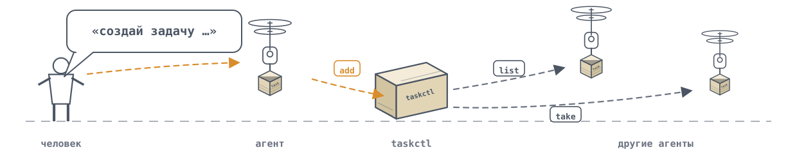
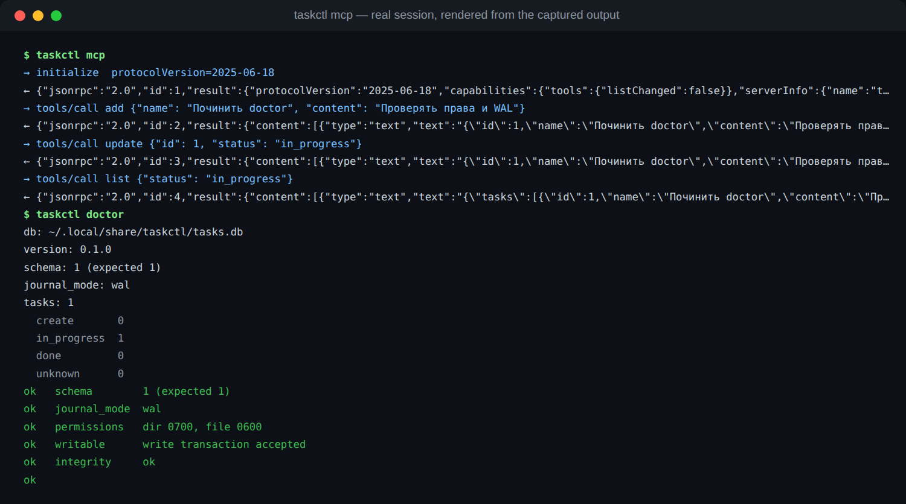
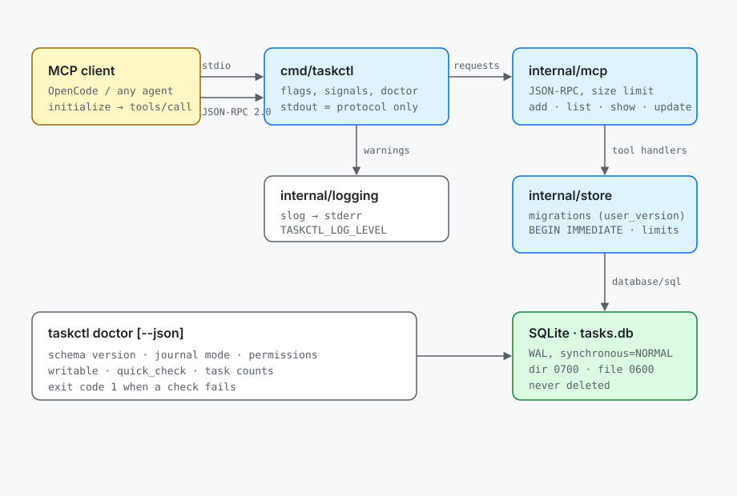

# taskctl

[](https://github.com/AlekseyShibayev/taskctl/actions/workflows/ci.yml)
[](https://github.com/AlekseyShibayev/taskctl/releases)
[](go.mod)
[](LICENSE)

[Русская версия](README.md) · [Changelog](CHANGELOG.md) · [Contributing](CONTRIBUTING.md) · [Security](SECURITY.md)



A local task tracker: MCP over stdio backed by SQLite on your machine, with no network access.

The tracker is the agent's working memory: tasks are created and updated from an MCP session, while the human only states what needs to be done.



## Design decisions

- **MCP instead of a CLI or files.** Argument schemas and error codes arrive at connect time, so nothing parses stdout; the CLI remains for install and diagnostics.
- **SQLite instead of a server.** One user, one machine, one `tasks` table, no background process.
- **No deletion.** Tasks are never deleted; a record stays in the database.
- **MCP is the only write path.** Tasks are managed through `add`/`list`/`show`/`update`; there are no CLI commands for them.

## Architecture



`cmd/taskctl` handles flags, signals and `doctor`; `internal/mcp` owns JSON-RPC, tool schemas and handlers; `internal/store` owns migrations, SQL and SQLite in WAL mode; `internal/logging` writes to stderr. stdout belongs to the protocol: anything but JSON-RPC there breaks the session.

## Contract

```yaml
tasks:
  id:         int, AUTOINCREMENT
  name:       str, 1..1024 UTF-8 bytes, stored without surrounding whitespace
  content:    str, 0..1 MiB UTF-8
  status:     enum create | in_progress | done
  created_at: datetime, UTC ISO-8601
```

The schema is versioned with `PRAGMA user_version`; migrations run in order inside one transaction.

## MCP tools

```yaml
tools:                    # * = optional
  add:    {args: [name, content*]}
  list:   {args: [status*, limit*, offset*], note: ordered by id}
  show:   {args: [id]}
  update: {args: [id, name*, content*, status*]}
```

Every tool has a `title` and `annotations`: `list`/`show` are `readOnlyHint`, `update` is `idempotentHint`, and none claims `destructiveHint`.

Details: `list` uses `limit` 50 (1..500), `offset`, `has_more`; `update` changes `status` only along allowed moves (`create → in_progress → done`, back via `in_progress → create`); errors are `{code, message}`; the database lives at `$XDG_DATA_HOME/taskctl/tasks.db`.

### Protocol versions

The server speaks `2024-11-05`, `2025-03-26` and `2025-06-18`, and answers an unknown version with `2025-06-18`. `initialize` is mandatory: before it, `tools/list` and `tools/call` return `-32002`.

## Examples

Each line is one JSON-RPC message terminated by `\n`. Examples are abbreviated.

### initialize

```json
→ {"jsonrpc":"2.0","id":1,"method":"initialize","params":{"protocolVersion":"2025-06-18","capabilities":{},"clientInfo":{"name":"opencode","version":"1"}}}
← {"jsonrpc":"2.0","id":1,"result":{"protocolVersion":"2025-06-18","capabilities":{"tools":{"listChanged":false}},"serverInfo":{"name":"taskctl","version":"0.1.0"}}}
```

### add

```json
→ {"jsonrpc":"2.0","id":2,"method":"tools/call","params":{"name":"add","arguments":{"name":"Fix doctor","content":"Check permissions and WAL"}}}
← {"jsonrpc":"2.0","id":2,"result":{"content":[{"type":"text","text":"{\"id\":1,\"name\":\"Fix doctor\",\"status\":\"create\",\"created_at\":\"2026-11-15T17:50:33Z\"}"}]}}
```

### list

```json
→ {"jsonrpc":"2.0","id":3,"method":"tools/call","params":{"name":"list","arguments":{"status":"in_progress","limit":2}}}
← {"jsonrpc":"2.0","id":3,"result":{"content":[{"type":"text","text":"{\"tasks\":[...],\"limit\":2,\"offset\":0,\"has_more\":false}"}]}}
```

### show

```json
→ {"jsonrpc":"2.0","id":4,"method":"tools/call","params":{"name":"show","arguments":{"id":1}}}
← {"jsonrpc":"2.0","id":4,"result":{"content":[{"type":"text","text":"{\"id\":1,\"name\":\"Fix doctor\",\"status\":\"in_progress\",...}"}]}}
```

### update

```json
→ {"jsonrpc":"2.0","id":5,"method":"tools/call","params":{"name":"update","arguments":{"id":1,"status":"done"}}}
← {"jsonrpc":"2.0","id":5,"result":{"content":[{"type":"text","text":"{\"id\":1,\"name\":\"Fix doctor\",\"status\":\"done\",...}"}]}}
```

### Errors

```json
← {"jsonrpc":"2.0","id":6,"result":{"content":[{"type":"text","text":"{\"code\":\"invalid_transition\",\"message\":\"cannot change status from done to create\"}"}],"isError":true}}
← {"jsonrpc":"2.0","id":7,"error":{"code":-32600,"message":"invalid request: jsonrpc must be \"2.0\""}}
```

Domain codes: `invalid_argument`, `not_found`, `invalid_transition`, `internal`. Protocol: `-32700` (parse error), `-32600` (invalid request / oversized message), `-32601` (method not found), `-32602` (invalid params), `-32603` (tool-call queue full), `-32002` (before initialize), `-32800` (cancelled or timed out).

## Install

```sh
git clone https://github.com/AlekseyShibayev/taskctl.git && cd taskctl && make install
```

Or grab a [release](https://github.com/AlekseyShibayev/taskctl/releases) binary (linux/amd64, linux/arm64).

MCP client settings: name `taskctl`, command `taskctl`, argument `mcp`, transport stdio. Use an absolute path when the client does not inherit `PATH`:

```sh
opencode mcp add taskctl --global -- "$HOME/.local/bin/taskctl" mcp
```

## Diagnostics

```sh
taskctl doctor          # schema, WAL, permissions, write access, integrity, counts
taskctl doctor --json   # for scripts; exit code 1 when a check fails
```

Checks: schema version, `journal_mode=wal`, directory `0700`/file `0600`, a write transaction, `PRAGMA quick_check`, and task counts including `unknown`.

Logs go to stderr only; set `TASKCTL_LOG_LEVEL=debug|info|warn|error` (default `warn`).

## Backup and restore

The WAL file is part of the database state, so copy data while the server is stopped (closing performs `wal_checkpoint(TRUNCATE)`):

```sh
# backup
cp -a ~/.local/share/taskctl ~/taskctl-backup-$(date +%F)
# restore
rm -rf ~/.local/share/taskctl
cp -a ~/taskctl-backup-2026-11-15 ~/.local/share/taskctl
taskctl doctor
```

If the server cannot be stopped, use `sqlite3 tasks.db ".backup '/path/backup.db'"`; that is the only safe way to copy a live database.

## Data deletion

MCP never deletes an individual task. To remove everything, stop the MCP server and delete the data directory.

```sh
rm -rf "${XDG_DATA_HOME:-$HOME/.local/share}/taskctl"
```

## Troubleshooting

| Symptom | Check |
| --- | --- |
| Client sees no tools | stdio transport, argument `mcp`, `initialize` first, a supported protocol version. |
| `taskctl: database is locked` | Another process holds the write lock longer than `busy_timeout` (5 s). Close extra MCP sessions. |
| `taskctl: ... permission denied` | The data directory must belong to the user and be `0700`; run `taskctl doctor`. |
| Client fails to parse responses | Something else writes to stdout (for example an `echo` in a wrapper). stdout is JSON-RPC only; logs go to stderr. |
| `version: dev` | The binary was built without a tag. Use a release artifact or build from a tagged checkout (`git describe`). |
| `tasks.db-wal`/`-shm` remain after a crash | Normal for WAL; SQLite recovers on the next open and `Close` checkpoints. |
| A task is missing from `list` | Check the `status` filter and `offset`; `has_more` points to the next page. |

## Compatibility

| Component | Support |
| --- | --- |
| OS | Linux (amd64, arm64); other OSes are not tested |
| Go | 1.25+ (see `go.mod`) |
| MCP | 2024-11-05, 2025-03-26, 2025-06-18 |
| SQLite | embedded `modernc.org/sqlite`, no CGO |
| Clients | any stdio MCP client; smoke-tested with the official Go SDK |

## Development

```sh
make check    # gofmt, vet, golangci-lint, -race tests, coverage ≥ 70%
make build    # bin/taskctl with the version from git describe
make cover    # coverage report
```

Releases: a `vX.Y.Z` tag runs GoReleaser (linux/amd64 and linux/arm64, checksums, changelog, GitHub Release). History follows Conventional Commits; changes go through pull requests.
