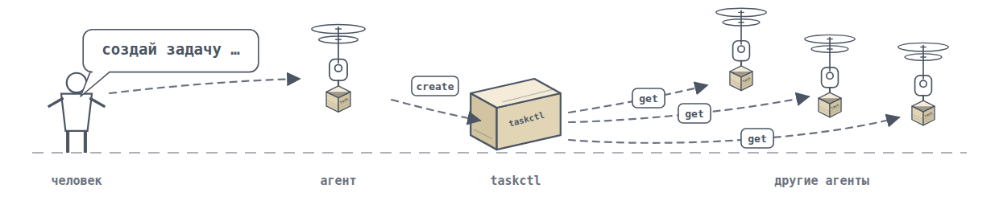

# taskctl



Локальная очередь задач для агента: MCP поверх stdio, SQLite на рабочей машине,
без сети. ОС: Linux.

`create` кладёт задачу, `get` атомарно забирает самую старую и удаляет её в той
же транзакции. Задача выдаётся не более одного раза.

## Установка

```sh
make install                      # ~/.local/bin/taskctl
```

База — `~/.local/share/taskctl/tasks.db` (или `$XDG_DATA_HOME/taskctl/tasks.db`),
создаётся при первой сессии.

MCP-клиент: `taskctl mcp`, stdio.

Контракт и критерии приёмки — `SPEC.md`.

## MCP-инструменты

| Инструмент | Аргументы |
|------------|-----------|
| `create`   | `text`    |
| `get`      |           |
