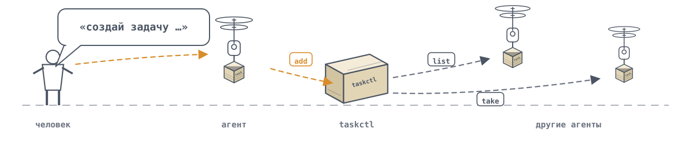
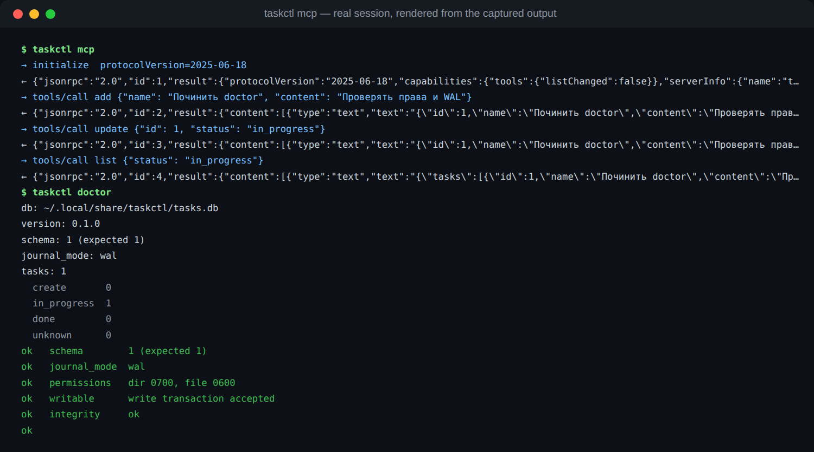
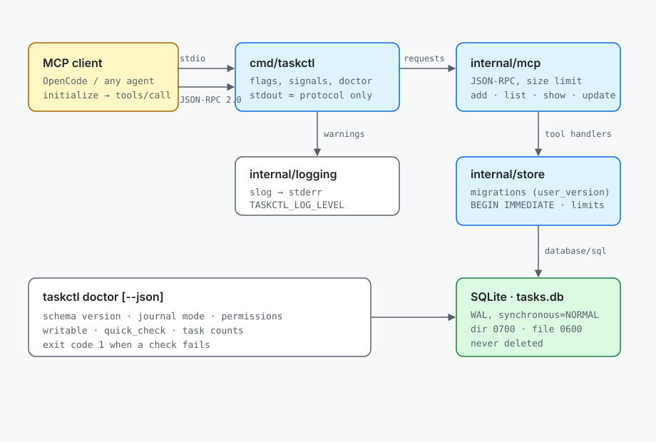

# taskctl

[](https://github.com/AlekseyShibayev/taskctl/actions/workflows/ci.yml)
[](https://github.com/AlekseyShibayev/taskctl/releases)
[](go.mod)
[](LICENSE)

[English version](README.en.md) · [Изменения](CHANGELOG.md) · [Участие](CONTRIBUTING.md) · [Безопасность](SECURITY.md)



Локальный трекер задач: MCP поверх stdio, база — SQLite на рабочей машине, без сети.

Трекер — рабочая память агента: задачи заводятся и ведутся из сессии MCP, человек только формулирует, что нужно.



## Ключевые решения

- **MCP вместо CLI и файлов.** Схемы аргументов и коды ошибок приходят при подключении, разбирать stdout не нужно; CLI остался для установки и диагностики.
- **SQLite вместо сервера.** Один пользователь, одна машина, одна таблица `tasks`, никаких фоновых процессов.
- **Отсутствие удаления.** Задачи не удаляются: запись остаётся в базе.
- **Работа только через MCP.** Задачи ведутся вызовами `add`/`list`/`show`/`update`; CLI-команд для этого нет.

## Архитектура



`cmd/taskctl` — разбор аргументов, сигналы, `doctor`; `internal/mcp` — JSON-RPC, схемы и обработчики инструментов; `internal/store` — миграции, SQL и SQLite в режиме WAL; `internal/logging` — журнал в stderr. stdout принадлежит протоколу: любая запись в него, кроме JSON-RPC, ломает сессию.

## Контракт

```yaml
tasks:
  id:         int, AUTOINCREMENT
  name:       str, 1..1024 байт UTF-8, хранится без крайних пробелов
  content:    str, 0..1 MiB UTF-8
  status:     enum create | in_progress | done
  created_at: datetime, UTC ISO-8601
```

Схема версионируется через `PRAGMA user_version`; миграции применяются по порядку в одной транзакции.

## MCP-инструменты

```yaml
tools:                    # * = необязательный
  add:    {args: [name, content*]}
  list:   {args: [status*, limit*, offset*], note: сортировка по id}
  show:   {args: [id]}
  update: {args: [id, name*, content*, status*]}
```

У инструментов заполнены `title` и `annotations`: `list`/`show` — `readOnlyHint`, `update` — `idempotentHint`, ни один не помечен `destructiveHint`.

Детали: `list` — `limit` 50 (1..500), `offset`, `has_more`; `update` меняет `status` только по разрешённым переходам (`create → in_progress → done`, назад — `in_progress → create`); ошибка — `{code, message}`; база — `$XDG_DATA_HOME/taskctl/tasks.db`.

### Версии протокола

Сервер понимает `2024-11-05`, `2025-03-26` и `2025-06-18`; на неизвестную версию отвечает `2025-06-18`. `initialize` обязателен: до него `tools/list` и `tools/call` возвращают `-32002`.

## Примеры

Каждая строка — отдельное сообщение JSON-RPC, разделитель — `\n`. Примеры сокращены.

### initialize

```json
→ {"jsonrpc":"2.0","id":1,"method":"initialize","params":{"protocolVersion":"2025-06-18","capabilities":{},"clientInfo":{"name":"opencode","version":"1"}}}
← {"jsonrpc":"2.0","id":1,"result":{"protocolVersion":"2025-06-18","capabilities":{"tools":{"listChanged":false}},"serverInfo":{"name":"taskctl","version":"0.1.0"}}}
```

### add

```json
→ {"jsonrpc":"2.0","id":2,"method":"tools/call","params":{"name":"add","arguments":{"name":"Починить doctor","content":"Проверять права и WAL"}}}
← {"jsonrpc":"2.0","id":2,"result":{"content":[{"type":"text","text":"{\"id\":1,\"name\":\"Починить doctor\",\"content\":\"Проверять права и WAL\",\"status\":\"create\",\"created_at\":\"2026-11-15T17:50:33Z\"}"}]}}
```

### list

```json
→ {"jsonrpc":"2.0","id":3,"method":"tools/call","params":{"name":"list","arguments":{"status":"in_progress","limit":2}}}
← {"jsonrpc":"2.0","id":3,"result":{"content":[{"type":"text","text":"{\"tasks\":[...],\"limit\":2,\"offset\":0,\"has_more\":false}"}]}}
```

### show

```json
→ {"jsonrpc":"2.0","id":4,"method":"tools/call","params":{"name":"show","arguments":{"id":1}}}
← {"jsonrpc":"2.0","id":4,"result":{"content":[{"type":"text","text":"{\"id\":1,\"name\":\"Починить doctor\",\"status\":\"in_progress\",...}"}]}}
```

### update

```json
→ {"jsonrpc":"2.0","id":5,"method":"tools/call","params":{"name":"update","arguments":{"id":1,"status":"done"}}}
← {"jsonrpc":"2.0","id":5,"result":{"content":[{"type":"text","text":"{\"id\":1,\"name\":\"Починить doctor\",\"status\":\"done\",...}"}]}}
```

### Ошибки

```json
← {"jsonrpc":"2.0","id":6,"result":{"content":[{"type":"text","text":"{\"code\":\"invalid_transition\",\"message\":\"cannot change status from done to create\"}"}],"isError":true}}
← {"jsonrpc":"2.0","id":7,"error":{"code":-32600,"message":"invalid request: jsonrpc must be \"2.0\""}}
```

Коды домена: `invalid_argument`, `not_found`, `invalid_transition`, `internal`. Протокол: `-32700` (parse error), `-32600` (invalid request / слишком большое сообщение), `-32601` (method not found), `-32602` (invalid params), `-32603` (очередь вызовов переполнена), `-32002` (до initialize), `-32800` (отмена или таймаут).

## Запуск

```sh
git clone https://github.com/AlekseyShibayev/taskctl.git && cd taskctl && make install
```

Или бинарь из [Releases](https://github.com/AlekseyShibayev/taskctl/releases) (linux/amd64, linux/arm64).

Подключение к MCP-клиенту: имя `taskctl`, команда `taskctl`, аргументы `mcp`, транспорт stdio. Указывайте абсолютный путь к бинарю, если клиент не наследует `PATH`:

```sh
opencode mcp add taskctl --global -- "$HOME/.local/bin/taskctl" mcp
```

## Диагностика

```sh
taskctl doctor          # человеку: схема, WAL, права, запись, целостность, счётчики
taskctl doctor --json   # скриптам; exit code 1, если проверка не прошла
```

Проверки: версия схемы, `journal_mode=wal`, права `0700` на каталог и `0600` на файл, возможность начать запись, `PRAGMA quick_check`, задачи по статусам (включая `unknown`).

Логи идут только в stderr; уровень задаётся `TASKCTL_LOG_LEVEL=debug|info|warn|error` (по умолчанию `warn`).

## Бэкап и восстановление

WAL-файл входит в состояние базы, поэтому копируйте данные при остановленном сервере (при закрытии выполняется `wal_checkpoint(TRUNCATE)`):

```sh
# бэкап
cp -a ~/.local/share/taskctl ~/taskctl-backup-$(date +%F)
# восстановление
rm -rf ~/.local/share/taskctl
cp -a ~/taskctl-backup-2026-11-15 ~/.local/share/taskctl
taskctl doctor
```

Если сервер остановить нельзя, используйте `sqlite3 tasks.db ".backup '/path/backup.db'"` — это единственный корректный способ снять копию на живой базе.

## Удаление данных

MCP не удаляет отдельные задачи. Чтобы удалить всё: остановите MCP-сервер и удалите каталог данных.

```sh
rm -rf "${XDG_DATA_HOME:-$HOME/.local/share}/taskctl"
```

## Troubleshooting

| Симптом | Что проверить |
| --- | --- |
| Клиент не видит инструменты | В конфиге транспорт stdio и аргумент `mcp`; сначала должен идти `initialize`; версия протокола клиента в списке поддерживаемых. |
| `taskctl: database is locked` | Другой процесс держит запись дольше `busy_timeout` (5 с). Закройте лишние MCP-сессии. |
| `taskctl: ... permission denied` | Каталог данных должен принадлежать пользователю и иметь режим `0700`; проверьте `taskctl doctor`. |
| Клиент падает на ответах | В stdout что-то пишет обёртка (например, `echo` перед запуском). stdout — только JSON-RPC, логи — stderr. |
| `version: dev` | Бинарь собран без тега. Поставьте релизный артефакт или соберите из репозитория с тегами (`git describe`). |
| После падения остались `tasks.db-wal`/`-shm` | Это нормально для WAL; при следующем открытии SQLite восстановит состояние, `Close` делает checkpoint. |
| Задача «пропала» из `list` | Проверьте `status`-фильтр и `offset`; `has_more` показывает, есть ли следующая страница. |

## Совместимость

| Компонент | Поддержка |
| --- | --- |
| ОС | Linux (amd64, arm64); другие ОС не тестируются |
| Go | 1.25+ (см. `go.mod`) |
| MCP | 2024-11-05, 2025-03-26, 2025-06-18 |
| SQLite | встроенный `modernc.org/sqlite`, без CGO |
| Клиенты | любые MCP-клиенты с stdio; smoke-тест с официальным Go SDK |

## Разработка

```sh
make check    # gofmt, vet, golangci-lint, тесты с -race, покрытие ≥ 70%
make build    # bin/taskctl с версией из git describe
make cover    # отчёт покрытия
```

Релиз: тег `vX.Y.Z` запускает GoReleaser — linux/amd64 и linux/arm64, checksums, changelog, GitHub Release. История — Conventional Commits, изменения через PR.
