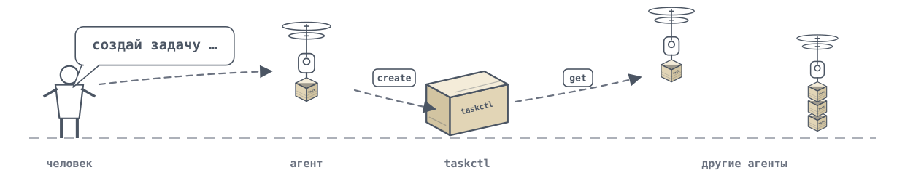

# taskctl



Локальная очередь задач для агента: MCP поверх stdio, SQLite на рабочей машине,
без сети. ОС: Linux.

`create` кладёт задачу, `get` атомарно забирает самую старую невзятую
(`get_at IS NULL`) и проставляет `get_at`. Задача берётся не более одного раза.

## Установка

```sh
make install                      # ~/.local/bin/taskctl
```

База — `~/.local/share/taskctl/tasks.db` (или `$XDG_DATA_HOME/taskctl/tasks.db`),
создаётся при первой сессии.

MCP-клиент: `taskctl mcp`, stdio.

## MCP-инструменты

| Инструмент | Аргументы |
|------------|-----------|
| `create`   | `text`    |
| `get`      |           |

## Схема данных

```yaml
tasks:
  id:         int
  text:       str
  create_at:  datetime
  get_at:     datetime  # null, пока задачу не взяли
```
